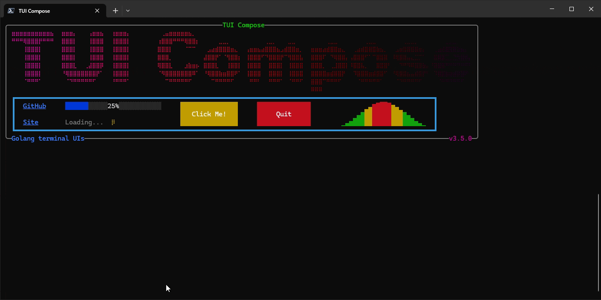

# TUI Compose
[](https://opensource.org/licenses/MIT)
[](https://github.com/romanSPB15/tui-compose/releases)
[](https://github.com/romanSPB15/tui-compose/actions/workflows/test.yaml)
[](https://github.com/romanSPB15/tui-compose/wiki)
[](https://github.com/romanSPB15/tui-compose/tree/main/examples)

**Лёгкий путь для создания приложений в терминале на Go.**

* 🍬 22 готовых виджета — полноценный набор:
    - **Базовые:**
        * Label, Button, Hyperlink, Gauge, InputField, Check, Frame(рамка).
    - **Изображения:**
        * Image(в tc-images).
    - **`extra/`**:
        * LineChart, BarChart, PieChart, Sparkline, Tree, Table, Tabs, Accordion, Spinner, BlinkLabel, PageIndicator, TextView, TextArea, Slider.
* 🎯 Полная поддержка мыши — клики, отпускание, скролл, движение.
* ✨ Автоматический фокус по Tab/Shift+Tab
* 🛠 Детекция data race при вызове методов окна — `-tags debug`
* 🎨 Удобная стилизация через битовые маски — быстро и удобно
* 🔧 Кастомные виджеты — 1-2 метода
* 🛒 Контейнеры — не нужно считать координаты вручную
* 🚀 TEA-надстройка — пишите реактивные приложения с ELM
* 📐 Flex: адаптивные вёрстки в терминале
* 🧱 Своё ядро — **acell**, без CGO, с 97% покрытием тестами и поддержкой Windows

---

<h3 align="center"><pre>go get -u github.com/romanSPB15/tui-compose/v4@v4.0.0-alpha</pre></h3>

## Быстрый старт
```go
package main

import (
	"strconv"

	"github.com/romanSPB15/tui-compose/v4"
)

func main() {
	wnd := tui.NewWindow()
	wnd.SetTitle("Моё приложение")

	label := tui.NewStaticLabel("0").WithStyle(tui.FrCyan)

	btnQuit := tui.NewButton("Выход", func() {
		wnd.Quit()
	})

	v := 0

	btnAdd := tui.NewButton("+", func() {
		v++
		label.SetText(strconv.Itoa(v))
		wnd.Redraw()
	}).WithStyle(tui.BgRed)

	btnSub := tui.NewButton("-", func() {
		if v > 0 {
			v--
			label.SetText(strconv.Itoa(v))
			wnd.Redraw()
		}
	}).WithStyle(tui.BgBlue)

	box := tui.NewVBox(label, tui.NewHBox(btnAdd, btnSub), btnQuit)
	wnd.SetContent(box)

	wnd.Run()
}
```

*Подробная документация доступна в [Wiki](https://github.com/romanSPB15/tui-compose/wiki).*<br>
*Другие примеры доступны в [examples](https://github.com/romanSPB15/tui-compose/tree/main/examples).*


## Сравнение с [Bubble Tea](https://github.com/charmbracelet/bubbletea)

| Критерий                     | tui-compose(v4.0.0)                              | Bubble Tea(v2.0.9)                   |
|------------------------------|--------------------------------------------------|--------------------------------------|
| Набор виджетов               | ✅ Большой(22) — от кнопок до графиков           | ⚠ Средний(13) — в Bubbles           |
| Производительность           | ✅ low-allocation, diff-рендер                   | diff, аллокации строк                |
| Зависимости                  | ✅ 2(только `x/sys` + `x/term` + `acell`)        | 15+                                  |
| Парадигма                    | ✅ Императивная + 2 надстройки — `react` + `tea` | Только ELM                           |
| Графики                      | ✅ Есть — LineChart, PieChart, Sparkline и другие| ⚠ Нет                               |
| Автоматический фокус         | ✅ Есть — по умолчанию                           | ⚠ Нет, ручное управление            |

## Лицензия
[**MIT**](https://github.com/romanSPB15/tui-compose/blob/main/LICENSE)

<div align="center">
  <h3>⭐ Нравится проект? Поддержи его звездой!</h3>
  <p>
    <a href="https://github.com/romanSPB15/tui-compose">
      
    </a>
  </p>
</div>
